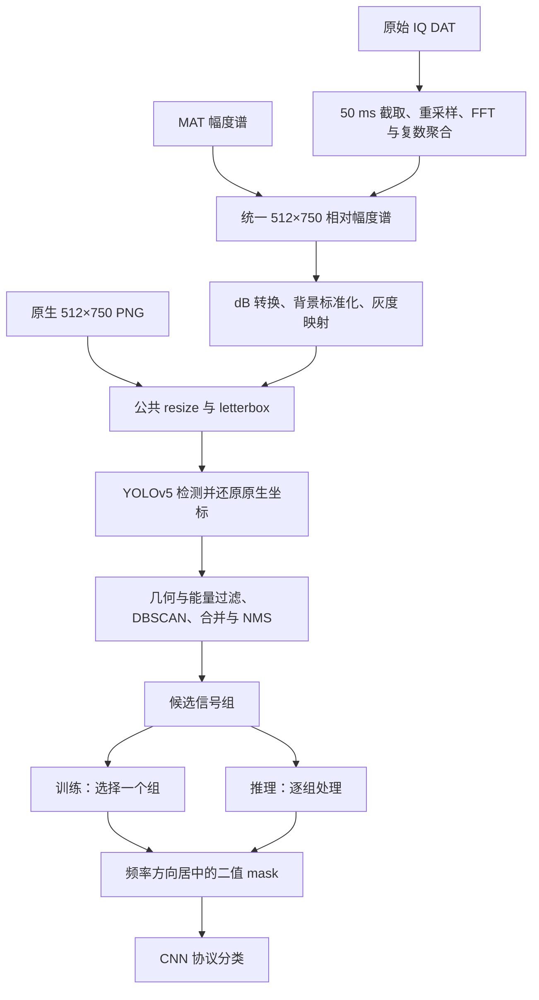

# UAV_detection

基于无线信号时频谱的无人机协议识别工程：使用 YOLOv5 检测信号帧，通过几何、能量与频率聚类生成候选信号组，再将每组转换为二值几何 mask，由 CNN 识别协议类别。

当前 `main` 支持单信号分类训练、MAT/PNG 多信号推理评估、原始 IQ `.dat` 训练和 LwF（Learning without Forgetting）类别增量学习。YOLO 检测器训练使用独立入口；主框架训练更新的是 CNN 分类器。

## 目录

- [整体框架](#整体框架)
- [环境与安装](#环境与安装)
- [数据准备](#数据准备)
- [分类训练与推理](#分类训练与推理)
- [LwF 增量学习](#lwf-增量学习)
- [YOLO 数据导出与检测器训练](#yolo-数据导出与检测器训练)
- [参数、缓存与输出](#参数缓存与输出)
- [验证与辅助工具](#验证与辅助工具)
- [当前限制](#当前限制)

## 整体框架



1. **统一频谱前端**：MAT/IQ 进入公共相对幅度表示，再执行一次灰度渲染；PNG 已是图像域，不重复做背景增强。
2. **检测与分组**：`YoloV5Detector` 输出原生坐标框。`SignalPreprocessor.select_signal_groups()` 保留通过质量阈值的多个候选组，提供中心频率、带宽及评分。
3. **构造分类输入**：训练器将组内框沿频率轴整体平移居中，框内填白、框外为黑；最近邻缩放到默认 `224×224`，形成 `[B,1,224,224]` 输入。时间位置与框间相对几何结构保留。
4. **单信号训练/验证**：MAT/PNG 根据频率真值选组，可选带宽约束；IQ 无频率真值，选择评分最高的组。没有可用组的样本不参与分类损失，但计入匹配率分母。
5. **多信号推理评估**：逐组分类后与真值匹配；未匹配组按 `Background` 真值计分，漏检目标按预测为 `Background` 计分，同时统计整图完全正确率。

分类器支持 `resnet18`、`resnet34`、`mobilenet_v3_small`。普通训练使用交叉熵、AdamW、余弦退火热重启，按验证准确率保存最佳模型并执行早停。LwF 额外对旧类 logits 加入教师蒸馏损失。

### 代码结构

```text
UAV_detection/
├── main.py                         # 参数、类别划分、训练/推理装配
├── data/
│   ├── data_loader.py              # MAT/PNG、文件名真值与数据划分
│   └── iq_dat_loader.py            # int16 IQ 读取、裁剪与目录类别
├── model/
│   ├── resnet.py                   # MaskImageClassifier 与三种 CNN 主干
│   └── losses.py                   # 损失辅助实现
├── util/
│   ├── spectrogram_frontend.py     # 幅度谱、灰度渲染与网络输入几何
│   ├── yolo_dataset_contract.py    # 实际 YOLO 加载器预处理适配
│   ├── detector.py                 # 本地 YOLOv5 推理封装
│   ├── preprocess.py               # 框过滤、聚类与信号组构建
│   ├── trainer.py                  # 居中 mask、训练与多信号评估
│   ├── lwf_trainer.py              # 教师/学生增量学习
│   ├── bboxcache.py                # 检测框缓存与配置指纹
│   ├── checkpoint.py              # 分类 checkpoint 保存/加载
│   ├── config.py                  # 默认类别与实验目录
│   ├── vis.py                     # 检测、分组和分类可视化
│   └── utils.py                   # 日志、指标与结果导出
├── scripts/                       # 数据导出、YOLO 训练及诊断
├── tests/                         # 前端、数据契约与标签工具测试
├── docs/                          # 算法及工具详细说明
├── yolov5/                        # Git 子模块，需初始化
├── run_*.sh                       # 实验示例，含作者本机绝对路径
├── requirements.txt               # 包含多种后端的依赖清单
├── environment.yaml               # 原 Linux/Conda 环境快照
└── Dockerfile                     # 使用上述 Conda 快照
```

mask 生成位于 `util/trainer.py`；当前没有 `util/boxmask.py`，也没有 `--mask_source` 参数。

## 环境与安装

以下多行命令使用 Bash 语法，在仓库根目录执行。Windows 可使用相应 Bash 环境，或将 Python 命令合并成一行。Python 可参考 CI 的 3.11，仓库环境快照使用 3.12；依赖清单的 PyTorch/torchvision 版本为 `2.6.0/0.21.0`。

### 获取仓库与子模块

```bash
git clone --branch main https://github.com/WuJiaqiii/UAV_detection.git
cd UAV_detection
git submodule sync --recursive
git submodule update --init --recursive
git submodule status yolov5
```

`.gitmodules` 使用 `git@github.com:WuJiaqiii/yolov5.git`，需要 GitHub SSH 访问。使用 HTTPS 时，可在当前克隆设置本地覆盖，再初始化：

```bash
git config submodule.yolov5.url https://github.com/WuJiaqiii/yolov5.git
git submodule update --init --recursive
```

本文核对的主仓库记录的 YOLO gitlink 为 `14d7b46c77855f5012d83d40c2288c7b68baa5ee`。后续更新以所用主仓库提交记录的 gitlink 为准，不根据旧文档另行切换 YOLO 提交。

### Python 依赖

下面是主框架安装依赖的起点；应结合机器选择 PyTorch 的 CPU/CUDA 安装方式，并安装实际 YOLO 子模块依赖。此示例不代表已验证的跨平台锁定环境。

```bash
python -m venv .venv
source .venv/bin/activate
python -m pip install --upgrade pip
python -m pip install torch==2.6.0 torchvision==0.21.0
python -m pip install numpy scipy scikit-learn opencv-python matplotlib PyYAML pytz tensorboard tqdm
python -m pip install -r yolov5/requirements.txt
python main.py --help
```

`requirements.txt` 还包含 TensorFlow、TensorRT、OpenVINO、Paddle 等后端；`environment.yaml` 含 Linux 构建标识和原机器 `prefix`，不宜直接视为跨平台最小安装方案。Dockerfile 依赖该环境快照，构建前也需核对平台与包源。

### 权重

- `--yolo_weights`：必填，已训练的信号帧检测器 `.pt`。
- `--checkpoint_path`：分类器 `.pth`，用于续训或推理，与 YOLO 权重不同。
- CNN 默认启用 torchvision 预训练权重，首次可能下载；`--no-mask_pretrained` 可关闭。

## 数据准备

### MAT / PNG：从文件名读取真值

`util/config.py` 默认有 7 个协议类别：

| ID | 类别 |
| --- | --- |
| 0 | Background |
| 1 | Lightbridge |
| 2 | Ocusync2 |
| 3 | Ocusync3 |
| 4 | Ocusync4 |
| 5 | Skylink1 |
| 6 | FPV |

排除类别或增量划分后会重新生成连续标签。文件名中的协议名必须匹配当前映射。

每个信号字段为 `Protocol-[字段0,中心频率,字段2,带宽]`。程序使用括号中第 2、4 个字段，单位为 MHz，带宽须大于 0；频率为相对于采样中心的频偏。可选 `-SNR-数值` 表示 SNR。

```text
dataset/
├── Lightbridge-[0,-10,0,20]-SNR-5-Figure-1.mat
├── Ocusync2-[0,15,0,10]-SNR-0-Figure-1.mat
└── Lightbridge-[0,-10,0,20]-Ocusync2-[0,15,0,10]-SNR-5-Figure-1.mat
```

前两项为单信号示例，第三项可用于多信号推理评估。训练只保留解析后恰好有一个目标的样本；背景样本也须满足文件名解析规则。

- **MAT**：默认读取 `summed_submatrices`，可用 `--mat_key` 修改；默认数据域为 `--mat_spec_domain amplitude`，也支持按实际含义声明 `power`、`db`、`image`。
- **PNG**：按灰度读取，必须为原生 `512×750`，不能含坐标轴、颜色条或预先缩放/补边。
- **扫描范围**：主框架 MAT/PNG 读取器只扫描指定目录的直接文件，不递归；路径参数支持依次传入多个目录或文件。
- **自动划分**：移除文件名末尾 `-Figure-数字` 后作为来源组进行训练/验证划分；只有一个来源组时退回样本随机划分。该规则不等同于采集会话隔离，正式实验需自行核对来源，必要时提供显式训练/验证路径。

### IQ DAT：从父目录读取类别

```text
iq_dataset/
├── DeviceA/
│   ├── recording_001.dat
│   └── recording_002.dat
└── DeviceB/
    ├── recording_003.dat
    └── recording_004.dat
```

文件布局为交错 `int16`：`I0,Q0,I1,Q1,...`，每个复采样点 4 字节，默认小端，可通过 `--iq_byte_order` 设置。类别按父目录名排序生成，不使用 MAT/PNG 固定协议映射，也不自动添加 `Background`。

训练随机截取 50 ms，验证截取中心片段。自动划分按录音文件分层，每类须有足够独立文件；也可显式指定训练和验证目录，自行保证采集来源隔离。读取器支持根目录下及下一层目录中的 `.dat` 文件。

### 统一频谱契约

| 项目 | 当前约定 |
| --- | --- |
| 频谱尺寸 | 512 行频率 × 750 列时间，50 ms |
| 输出采样网格 | 122.88 MHz，`--sampling_rate` 须保持此值 |
| IQ 源采样率 | 默认 100 MHz，也支持 122.88 MHz |
| IQ 算法 | 必要时重采样 → 周期 Hamming → FFT 512、hop 512 → fftshift → 每 16 帧复数求和后取模 |
| 幅度表示 | 最大值归一化、uint16 量化规则、float32 相对幅度 |
| 频率方向 | 第 0 行最低；bin 从 -61.44 到 +61.20 MHz，间隔 0.24 MHz |
| 灰度渲染 | `20log10` → 背景标准化 → 固定范围 uint8 映射 |
| 默认背景统计 | `global`，中央 ±50 MHz 参考区，中位数及 MAD 稳健尺度 |
| 网络几何 | 标注保持 512×750；YOLO 输入再 resize/letterbox，默认 640×640 |

`--iq_segment_ms 50 --iq_n_fft 512 --iq_hop_length 512` 为固定兼容设置。MAT 不重做 STFT，不通过图像缩放掩盖矩阵尺寸不一致。完整算法、数据域与迁移说明见[统一频谱前端](docs/spectrogram_frontend.md)。

## 分类训练与推理

以下 `/data/...`、`/models/...` 均为待替换路径。`--frontend_config` 指向 YOLO 训练数据导出的 `frontend_config.json`，用于保持频谱与渲染参数一致；不用 manifest 时须自行保证一致性。

### MAT 单信号训练

```bash
python main.py \
  --run_mode train --input_type mat --mat_spec_domain amplitude \
  --train_dataset_path /data/single/train \
  --val_dataset_path /data/single/val \
  --yolo_weights /models/signal_detector.pt \
  --frontend_config /data/yolo_v2/frontend_config.json \
  --backbone resnet18 --no-mask_pretrained \
  --batch_size 32 --num_workers 4 --epochs 50 --lr 1e-4
```

自动划分时，用 `--dataset_path /data/single --val_ratio 0.2` 替代两项显式路径；显式路径必须同时提供。PNG 改用 `--input_type png`，移除 MAT 数据域参数。

### IQ 单信号训练

```bash
python main.py \
  --run_mode train --input_type iq_dat \
  --dataset_path /data/iq_dataset \
  --iq_sample_rate 100000000 \
  --iq_segment_ms 50 --iq_n_fft 512 --iq_hop_length 512 \
  --yolo_weights /models/signal_detector.pt \
  --frontend_config /data/yolo_v2/frontend_config.json \
  --bbox_cache_mode off --backbone resnet18 --no-mask_pretrained \
  --batch_size 32 --num_workers 4 --epochs 50 --lr 1e-4
```

IQ 随机裁剪禁止文件级 bbox 缓存。当前 `infer` 要求频率真值，不支持 `iq_dat`。

### 续训与多信号推理评估

> 当前 checkpoint 接口问题会阻断这两项功能，须先修复[当前限制](#当前限制)中的参数不一致。

普通续训在原训练命令中添加 `--checkpoint_path /models/classifier.pth`。程序尝试恢复模型、优化器、调度器、最佳准确率及下一 epoch；`--epochs` 表示总目标轮数。须保持 backbone、mask 参数、类别集合与标签顺序一致，checkpoint 不自动恢复全部命令行配置。

```bash
python main.py \
  --run_mode infer --input_type mat --mat_spec_domain amplitude \
  --dataset_path /data/multi_signal_eval \
  --yolo_weights /models/signal_detector.pt \
  --checkpoint_path /models/classifier.pth \
  --frontend_config /data/yolo_v2/frontend_config.json \
  --backbone resnet18 --no-mask_pretrained \
  --batch_size 32 --num_workers 4
```

这是带真值的离线评估，文件名须提供协议、中心频率和带宽，类别空间须保留 `Background`。增量模型还需传入对应的 `--incremental_split_mode incremental --incremental_new_classes ...`，以及与训练相同的排除设置，重建相同标签顺序。

## LwF 增量学习

以 `Skylink1` 为新类，其余默认类别为旧类：

```bash
# 阶段一：基础类别训练，过滤新类
python main.py \
  --run_mode train --input_type mat \
  --train_dataset_path /data/single/train \
  --val_dataset_path /data/single/val \
  --yolo_weights /models/signal_detector.pt \
  --frontend_config /data/yolo_v2/frontend_config.json \
  --trainer_type normal --incremental_split_mode base \
  --incremental_new_classes Skylink1 --no-mask_pretrained

# 阶段二：新类训练，验证集保留全部类别
python main.py \
  --run_mode train --input_type mat \
  --train_dataset_path /data/single/train \
  --val_dataset_path /data/single/val \
  --yolo_weights /models/signal_detector.pt \
  --frontend_config /data/yolo_v2/frontend_config.json \
  --trainer_type lwf --incremental_split_mode incremental \
  --incremental_new_classes Skylink1 \
  --lwf_teacher_checkpoint /models/base_classifier_best.pth \
  --lwf_temperature 4 --lwf_lambda_kd 10 --no-mask_pretrained
```

第二阶段必须显式提供训练和验证路径；训练自动只保留新类，验证保留旧类与新类。学生类别顺序为“旧类在前，新类按参数顺序追加”，旧类数量默认自动推导。教师主干、旧类集合与顺序必须与第一阶段一致。

教师冻结，学生加载兼容权重并复制旧类分类头；损失为 `CE + lwf_lambda_kd × KD`，KD 只作用于旧类输出。`--lwf_freeze_backbone` 可只训练分类头。LwF 教师初始化使用独立加载函数，与普通续训的 checkpoint 加载路径不同。

## YOLO 数据导出与检测器训练

检测标注类别与 CNN 协议类别是两套概念。公共导出器默认使用单类 `0=signal_frame`。

```bash
# 1. MAT 导出原生 PNG，并按来源分组
python scripts/export_iq_yolo_dataset.py \
  --input_dir /data/mat_source --output_dir /data/yolo_v2 \
  --input_type mat --mat_spec_domain amplitude \
  --frontend_mode global --split_mode group --val_ratio 0.2

# 2. 在导出 PNG 上人工标注，将 YOLO txt 保存到对应 labels 路径
# 全部标注完成后检查并生成 data.yaml
python scripts/export_iq_yolo_dataset.py \
  --output_dir /data/yolo_v2 --finalize

# 3. 使用公共适配入口训练 YOLO
python scripts/train_yolo_frontend.py \
  --dataset /data/yolo_v2 --weights /models/yolov5_initial.pt \
  --epochs 100 --batch_size 16
```

导出目录须为空且位于源目录之外。正式分组至少需要两个独立来源组，可通过 `--groups_json` 指定采集会话。预览使用 `--split_mode none`，输出在 `images/unassigned`，不能直接 finalize 成正式训练集。无信号图片也须人工确认并保存空 txt，未标注图片不自动视为背景。

导出物包括 `images/`、`labels/`、`metadata.jsonl`、`frontend_config.json`；完成检查后才生成 `data.yaml`。MAT 保留相对目录和文件名，仅改扩展名；IQ 按切片生成图像并使用哈希命名，同一录音的切片保持在同一划分。

IQ 导出改用 `--input_type iq_dat --iq_sample_rate 100000000 --segments_per_file 1`。MAT manifest 也可用于主框架 IQ 输入，不会把 MAT 来源采样率覆盖到 IQ 采集速率。

`train_yolo_frontend.py` 通过内存适配器让实际 YOLO 加载器使用公共 resize；基线禁用随机增强、multi-scale 和 rect batching。普通 `yolov5/train.py` 不保证与主框架输入张量一致。旧版方形图片、标注、manifest 与权重应重新导出、复核及评估。

## 参数、缓存与输出

完整参数以 `python main.py --help` 为准：

| 参数 | 默认值 / 说明 |
| --- | --- |
| `--run_mode` | `train`；`infer` 为带真值评估 |
| `--input_type` | `mat`；另支持 `png`、`iq_dat` |
| `--train_signal_mode` | 仅支持 `single` |
| `--backbone` / `--mask_img_size` | `resnet18` / `224` |
| `--mask_in_chans` / `--mask_fill_value` | `1` / `255`；当前必须单通道 |
| `--mask_pretrained` | 默认开启，关闭使用 `--no-mask_pretrained` |
| `--yolo_conf_thres` / `--yolo_iou_thres` | `0.05` / `0.30` |
| `--match_freq_thresh` | `30.0` MHz，频率匹配阈值 |
| `--match_use_bandwidth` / `--match_bw_thresh` | 默认不启用带宽约束 / `20.0` MHz |
| `--exclude_classes` | 从数据及模型类别空间排除 |
| `--eval_exclude_classes` | 评估忽略指定类别，不改变分类头 |
| `--val_ratio` / `--sample_ratio` | `0.2` / `1.0`，后者控制训练抽样比例 |
| `--batch_size` / `--num_workers` | `32` / `4` |
| `--epochs` / `--lr` / `--weight_decay` | `50` / `1e-4` / `1e-2` |
| `--early_stop_patience` / `--save_interval` | `20` / `5` |
| `--bbox_cache_mode` | `off`，另支持 `read/write/refresh/readwrite` |
| `--val_detect_vis_ratio` / `--infer_detect_vis_ratio` | `0.01` / `1.0` |

MAT/PNG 训练命令可添加 `--bbox_cache_mode readwrite --bbox_cache_path /data/cache/yolo_v2`。启用缓存须提供目录。缓存存储 YOLO 原始框，后处理和 mask 按当前参数重算；缓存指纹包含检测器与前端配置。数据或权重原地替换后应显式刷新缓存。IQ 随机裁剪须保持 `off`。

每次运行创建 `experiments/UAV_YYYYMMDD_HHMMSS/`，时间使用 Asia/Shanghai：

```text
experiments/UAV_YYYYMMDD_HHMMSS/
├── config.yaml
├── models/                         # best.pth、epoch_N.pth
├── log/                            # train_log.log / infer_log.log、TensorBoard
├── cache/                          # 预留目录；框缓存使用显式指定的路径
└── result/
    ├── confusion_matrix/           # 混淆矩阵图及 numpy 数组
    ├── eval_summary/               # JSON 指标、实例 CSV
    ├── detect_result/              # 检测、分组、匹配与分类图
    └── classifier_input_masks/     # 原生居中 mask、CNN 输入 mask、叠加图
```

单信号验证 `acc` 只统计成功生成分类实例的样本，须同时查看 `match_recall`。多信号推理 `acc` 还计入未匹配组和漏检目标，`image_exact_acc` 衡量整图完全正确率，两种模式的准确率口径不同。推理 `loss` 固定写为 `0.0`，不表示计算了交叉熵。

## 验证与辅助工具

```bash
# 单元测试
python -m unittest discover -s tests -v

# 合成前端诊断
python scripts/evaluate_frontend.py --output_dir work/frontend-diagnostics

# 导出 PNG 与原始输入重建的一致性
python scripts/check_yolo_input_equivalence.py \
  --dataset /data/yolo_v2 --source_root /data/mat_source --limit 20

# 实际 YOLO 后端检查，需要子模块、依赖及真实权重
python scripts/check_yolo_input_equivalence.py \
  --dataset /data/yolo_v2 --source_root /data/mat_source \
  --yolo_weights /models/signal_detector.pt --device cpu --limit 20
```

测试覆盖频谱公式、MAT/IQ 适配、原生 PNG、网络几何和分组标注契约。实际 YOLO 测试需按测试文件要求设置 `UAV_TEST_REAL_YOLO=1`。合成诊断及随机初始化网络的张量检查不证明实测检测精度或 mAP。

其他工具：

- `scripts/plot_mat_to_png.py`：公共导出流程的 MAT 默认入口。
- `scripts/remap_yolo_labels.py`：保留检测类别 0/1/2，其余非负整数改为 0；支持 dry-run、备份及缓存失效。见[标签重映射说明](docs/remap_yolo_labels.md)。三类数据不能使用公共导出器的单类 finalize。
- `scripts/generate_fake_yolo_dataset*.py`、`generate_background*.py`：合成数据与背景辅助脚本，运行前核对内部路径、数据假设及参数，产物须按当前前端契约检查。

## 当前限制

- **checkpoint 接口不一致**：`Trainer.__init__()` 调用 `load_training_checkpoint(..., expected_classes=...)`，但 `util/checkpoint.py` 的函数签名没有 `expected_classes`，会报 `TypeError`。普通续训及推理受到影响；应统一接口并验证类别映射。本文仅更新 README，未修改代码。
- **运行模式**：主框架拒绝多信号训练、DDP（`WORLD_SIZE>1`）、`--use_data_parallel` 及 `--use_amp_autocast`；参数存在不代表已实现。分类器自动选择 CUDA 或 CPU，`--yolo_device` 只控制检测器。
- **IQ 限制**：目录类别不提供真实中心频率/带宽，不能进入当前端到端推理评估；随机裁剪禁止文件级检测框缓存。
- **脚本路径**：`run_train*.sh`、`run_inference.sh` 含作者本机绝对路径；当前 `run_train_iq.sh` 未接入 `UAV_*` 环境变量，manifest 参数被注释。请使用本文命令或自行修改脚本。
- **历史文档差异**：`docs/spectrogram_frontend.md` 的算法说明可参考，但末尾关于修复未合并、YOLO 提交 `88af13e...`、IQ 环境变量启动方式的叙述与本文核对的 `main` 不一致。版本和运行行为以实际代码及主仓库 gitlink 为准。
- **验证范围**：实测录音、人工检测标注和训练权重未随仓库提供，本文不声明模型精度、完整训练运行或所有平台安装已验证。
